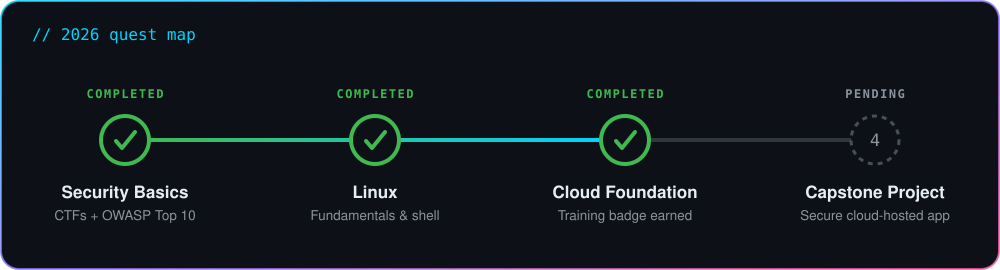

<!-- ═════════════ HERO ═════════════ -->

  

  
  
  

<!-- ═════════════ TERMINAL ═════════════ -->

  

<!-- ═════════════ TECH ═════════════ -->
<h2 align="center">⚡ Tech I Work With</h2>

  

<!-- ═════════════ ROADMAP ═════════════ -->
<h2 align="center">🧭 My 2026 Quest Map</h2>

  

<!-- ═════════════ PROJECTS ═════════════ -->
<h2 align="center">🚀 Featured Projects</h2>

🏆 Built during hackathons

  
  

  

<!-- CodeCrucible: add this block back once the repo is public (see note below)

  

-->

<!-- ═════════════ STATS ═════════════ -->
<h2 align="center">📊 GitHub Pulse</h2>

  
  

  

<!-- Snake needs the snake.yml workflow (see setup steps) -->

  <picture>
    <source media="(prefers-color-scheme: dark)" srcset="https://raw.githubusercontent.com/RashmiBansal-30/RashmiBansal-30/output/github-snake-dark.svg?v=2" />
    <source media="(prefers-color-scheme: light)" srcset="https://raw.githubusercontent.com/RashmiBansal-30/RashmiBansal-30/output/github-snake.svg?v=2" />
    
  </picture>

<!-- ═════════════ CONNECT ═════════════ -->
<h2 align="center">🤝 Let's Connect</h2>

  
  
  
  
  
  

<!-- ═════════════ FOOTER ═════════════ -->

  

